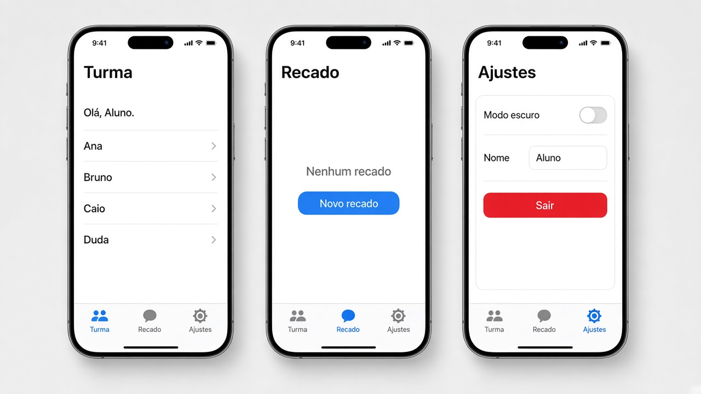
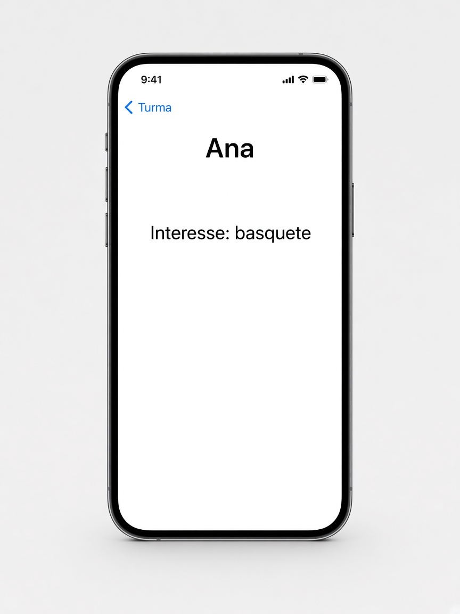
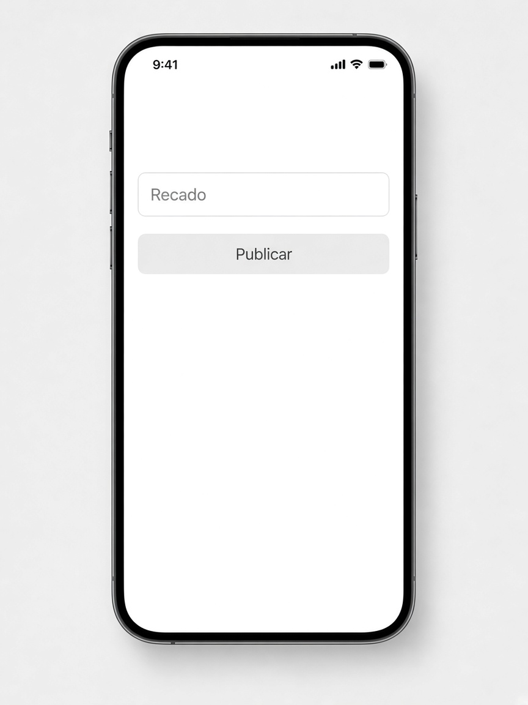
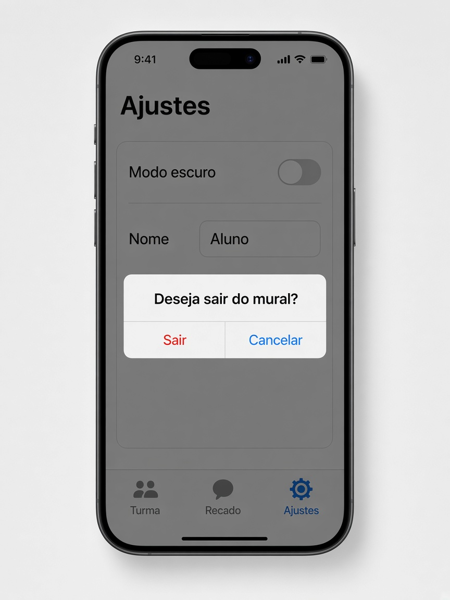
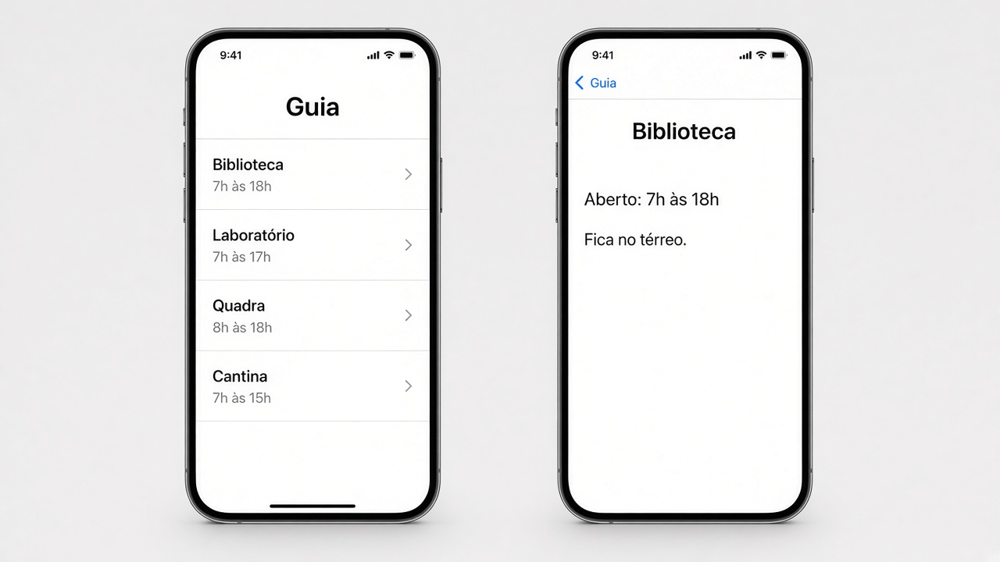
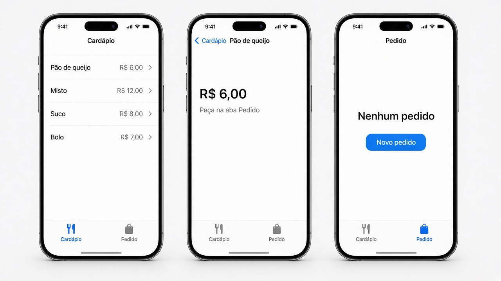
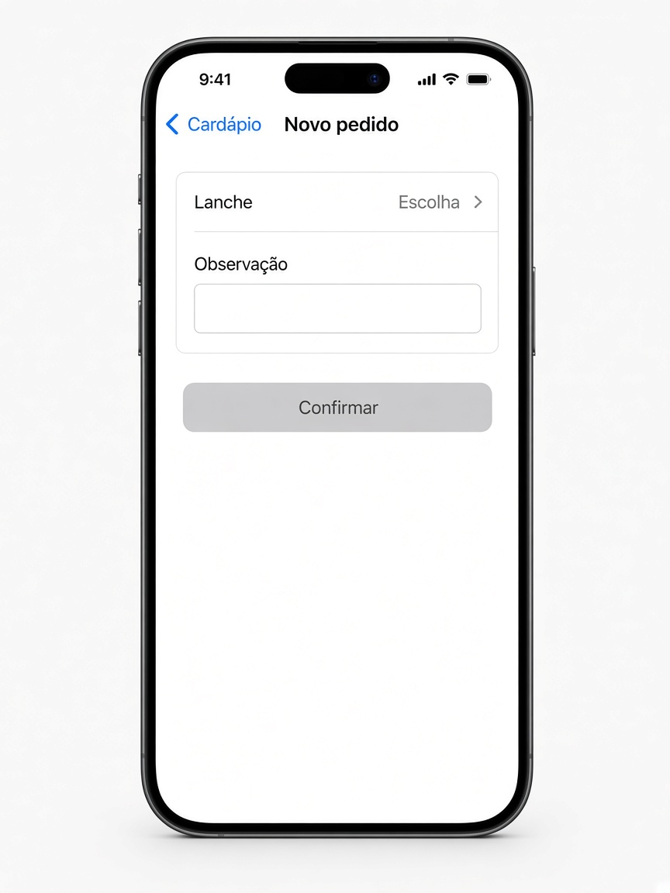

# Capítulo 8 — O que fazer

**Desenvolvimento iOS · 3º ano**

São três exercícios sobre trocar de tela. Faça o seu primeiro, nos arquivos da pasta do exercício. A resolução pronta está em `Resolucoes`, na pasta do projeto, fora do app.

`NavigationLink` só funciona dentro de um `NavigationStack`. A sheet não entra na pilha: ela sobe por cima da tela atual e fecha com `dismiss()`.

Em cada exercício, a parte **Componentes** diz o que usar. Para tirar os espaços das pontas de um texto, use `trimmingCharacters(in: .whitespaces)`.

---

## 1. Mural da turma

Pasta: `1 - Mural da turma`

Exemplo de layout. A barra de baixo é a mesma nas três abas. A aba do meio se chama **Recado**.

O toque num colega abre o detalhe.

**Novo recado** abre esta sheet. Com o campo vazio, **Publicar** fica cinza.

O alerta de sair aparece por cima dos Ajustes.

Depois de sair, a aba mostra “Sessão encerrada”.

Três abas. Cada uma é uma view. Cada aba tem ícone e título:

- **Turma**, ícone `person.2`
- **Recado**, ícone `text.bubble`
- **Ajustes**, ícone `gearshape`

Na tela das abas, guarde:

- o nome do usuário, começando em “Aluno”
- o modo escuro, começando desligado

O modo escuro fica na `TabView`, para valer nas três abas. Passe o nome e o modo escuro para as abas que precisam ler ou mudar esses valores.

**Componentes de `MuralView`**

- Dois `@State`: `nomeUsuario` em “Aluno” e `modoEscuro` em falso.
- `TabView`.
- Cada aba usa `.tabItem { Label("Turma", systemImage: "person.2") }`, e o mesmo para Recado e Ajustes.
- `.preferredColorScheme(modoEscuro ? .dark : .light)` fica no `TabView`, não dentro de uma aba só.
- A Turma recebe o nome para ler. Ajustes recebe `$nomeUsuario` e `$modoEscuro`, porque essa aba escreve nos dois.

### Aba Turma

Dentro de um `NavigationStack`:

- título **Turma**
- o texto “Olá, (nome)”
- uma lista com pelo menos quatro colegas. Cada um tem nome e interesse
- cada linha é um `NavigationLink`. O que aparece na linha é o nome e o ícone `chevron.right`
- o destino recebe aquele colega

No detalhe, o título da barra é o nome do colega. O texto mostra o interesse, por exemplo “Interesse: basquete”.

**Componentes**

- `struct Colega: Identifiable`, com nome e interesse.
- `NavigationStack` e `List`.
- `Text("Olá, \(nomeUsuario)")`.
- `ForEach` com `NavigationLink`. O rótulo da linha é um `HStack`: o nome e `Image(systemName: "chevron.right")`.
- O destino é `ColegaDetalheView(colega: colega)`. Aqui pode passar o colega direto, porque o detalhe só lê.
- No detalhe, `Text("Interesse: \(colega.interesse)")` e `.navigationTitle(colega.nome)`.
- `.navigationTitle("Turma")` na lista.

### Aba Recado

Dentro de outro `NavigationStack`, separado do da Turma:

- título **Recado**
- o texto do recado publicado, ou “Nenhum recado” quando ainda não houver
- um botão **Novo recado**, que abre uma sheet

A view da sheet recebe o texto publicado por `@Binding`. Ela tem um campo e um botão **Publicar**.

- **Publicar** fica desabilitado se o campo, sem espaços nas pontas, estiver vazio
- ao tocar, grava o texto e fecha a sheet com `dismiss()`

A sheet não recebe o Bool que a abriu. Quem fecha é o `dismiss`.

**Componentes da aba**

- `@State` do recado publicado, começando vazio, e um `@State` Bool da sheet.
- `NavigationStack`, um `VStack`, um `Text` e `Button("Novo recado")`.
- Se o recado estiver vazio, o `Text` mostra “Nenhum recado”.
- `.sheet(isPresented:)` abre o formulário com `$recadoPublicado`.
- `.navigationTitle("Recado")`.

**Componentes da sheet**

- `@Binding var recadoPublicado: String`.

- `@State` do rascunho. A string publicada só muda no **Publicar**.
- `TextField("Recado", text:)` com `.textFieldStyle(.roundedBorder)`.
- `Button("Publicar")` com `.disabled` enquanto o rascunho, sem espaços, estiver vazio.
- No toque: grave o texto no `Binding` e chame `dismiss()`.

### Aba Ajustes

Um `Form` com:

- toggle “Modo escuro”
- campo do nome. O que for digitado aqui aparece no “Olá” da aba Turma
- botão **Sair**, que abre um alerta: “Deseja sair do mural?”

O alerta tem dois botões. **Sair** muda um texto desta aba para “Sessão encerrada”. **Cancelar** só fecha o alerta.

**Componentes**

- Dois `@Binding`: nome e modo escuro. É por isso que o “Olá” da Turma acompanha o campo.
- `@State` do Bool do alerta e `@State` do texto de sessão, começando vazio.
- `Form` com `Toggle("Modo escuro", isOn:)`, `TextField("Nome", text:)` e `Button("Sair")`.
- O botão só liga o Bool do alerta.
- `.alert("Deseja sair do mural?", isPresented:)`.
- **Sair** usa `Button("Sair", role: .destructive)` e grava “Sessão encerrada”.
- **Cancelar** usa `Button("Cancelar", role: .cancel)`.

---

## 2. Guia da escola

Pasta: `2 - Guia da escola`

Exemplo de layout.

Só pilha. Sem aba.

Uma lista com pelo menos quatro lugares da escola. Cada lugar tem nome, horário e piso.

Cada linha é um `NavigationLink`. O destino recebe aquele lugar.

No detalhe:

- o título da barra é o nome do lugar
- aparece o horário
- aparece o piso

**Componentes**

- `struct LocalEscola: Identifiable`, com nome, horário e piso.
- Uma lista fixa com pelo menos quatro lugares, dentro da view.
- `NavigationStack` e `List`.
- `ForEach` com `NavigationLink`. A linha mostra o nome e, embaixo, o horário, com `.font(.caption)`.
- O destino é `LocalDetalheView(local:)`.
- No detalhe, dois `Text`: o horário e o piso. `.navigationTitle(local.nome)`.
- `.navigationTitle("Guia")` na lista.

---

## 3. Cantina

Pasta: `3 - Cantina`

Exemplo de layout.

**Novo pedido** abre esta sheet. Sem lanche escolhido, **Confirmar** fica cinza.

Depois de confirmar, a aba Pedido mostra, por exemplo, “Pão de queijo — sem gluten”.

Duas abas: **Cardápio** e **Pedido**.

O texto do pedido nasce na tela das abas. A aba Pedido lê esse texto. A sheet grava nele.

**Componentes de `CantinaView`**

- `@State` do texto do pedido, começando vazio.
- `TabView`.
- `.tabItem` com `Label("Cardápio", systemImage: "fork.knife")` e `Label("Pedido", systemImage: "bag")`.
- A aba Pedido e a sheet recebem `$pedido`. O cardápio não precisa desse texto.

### Cardápio

Um `NavigationStack` só desta aba.

Uma lista de lanches, cada um com nome e preço. O toque abre o detalhe daquele lanche. No detalhe, o título é o nome e o preço aparece na tela.

**Componentes**

- `struct Lanche: Identifiable`, com nome e preço.
- `NavigationStack`, `List` e `ForEach`.
- Cada linha é um `NavigationLink` com o nome e o preço.
- No detalhe, um `Text` do preço e `.navigationTitle(lanche.nome)`.
- `.navigationTitle("Cardápio")`.

### Pedido

Mostra o pedido feito, ou “Nenhum pedido” quando ainda não houver.

O botão **Novo pedido** abre uma sheet. Na sheet:

- um `Picker` para escolher o lanche
- um campo de observação
- **Confirmar** grava o pedido e fecha com `dismiss()`
- sem lanche escolhido, **Confirmar** fica desabilitado

Se houver observação, ela entra no texto do pedido junto com o nome do lanche.

**Componentes da aba**

- `@Binding` do texto do pedido e um `@State` Bool da sheet.
- `VStack` com um `Text` e `Button("Novo pedido")`.
- Se o texto estiver vazio, mostre “Nenhum pedido”.
- `.sheet(isPresented:)` abre o formulário com a lista de lanches e o `$pedido`.
- `.navigationTitle("Pedido")`.

**Componentes da sheet**

- `@Binding var pedido: String` e a lista de lanches.

- `@State` do lanche escolhido, um `UUID?` que começa `nil`, e `@State` da observação.
- `NavigationStack` com título **Novo pedido**.
- `Form` com `Picker("Lanche", selection:)`. A primeira opção é `Text("Escolha").tag(UUID?.none)`. Depois, `ForEach` dos lanches.
- `TextField("Observação", text:)`.
- `Button("Confirmar")` com `.disabled` enquanto nada foi escolhido.
- No toque: se a observação, sem espaços, estiver vazia, grave só o nome. Se tiver texto, grave “nome — observação”. Depois, `dismiss()`.
