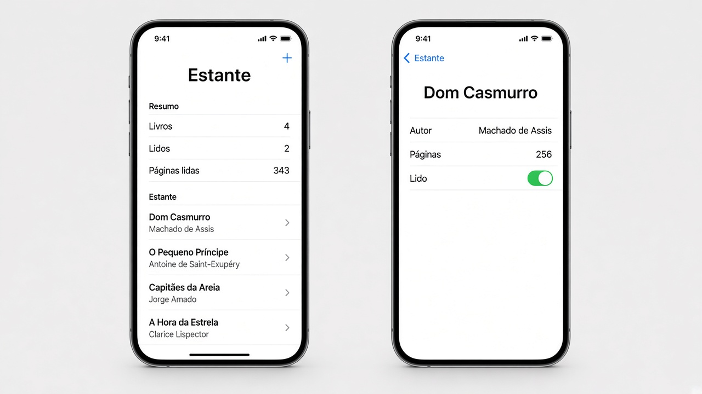
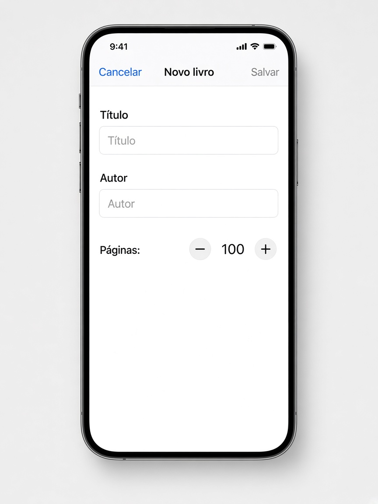
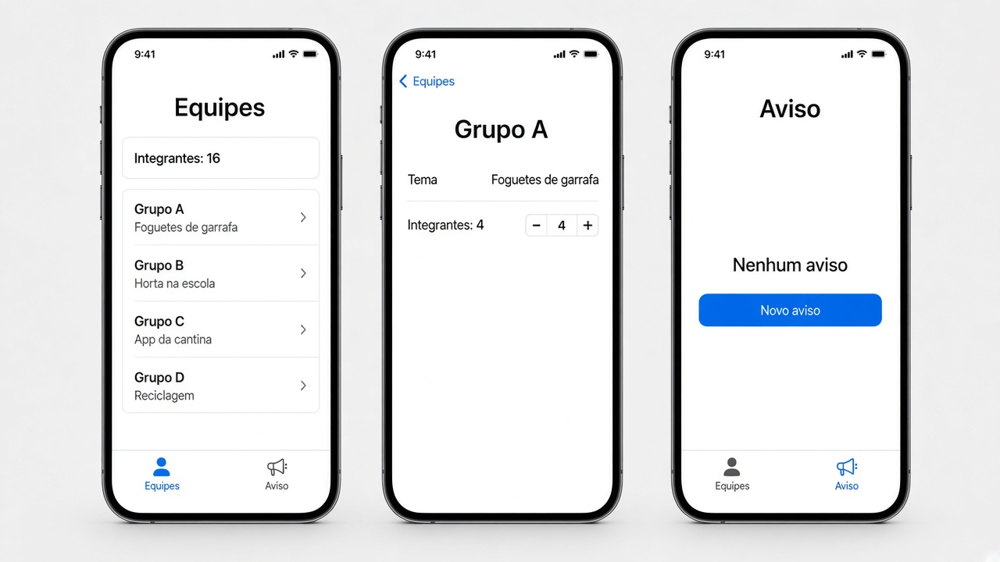
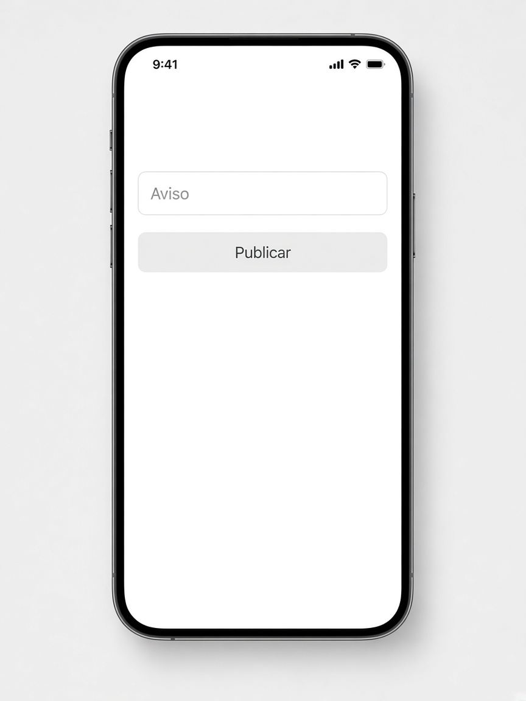
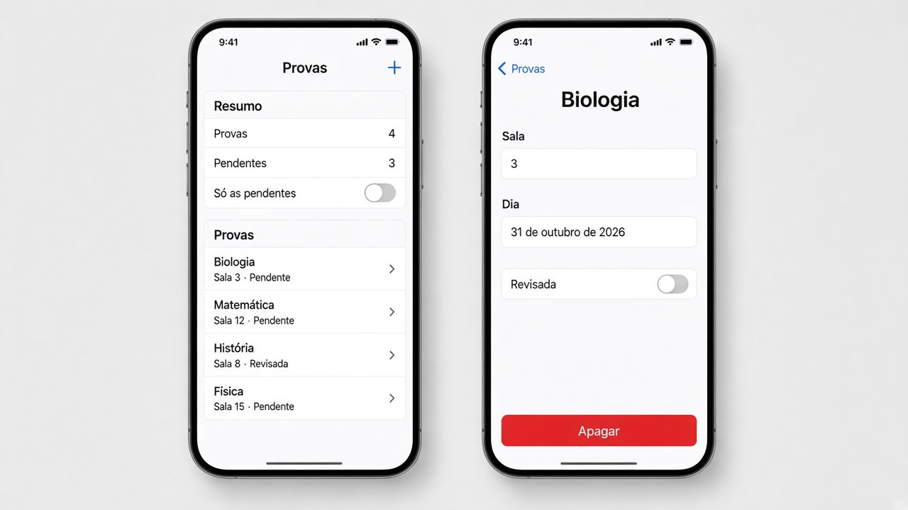
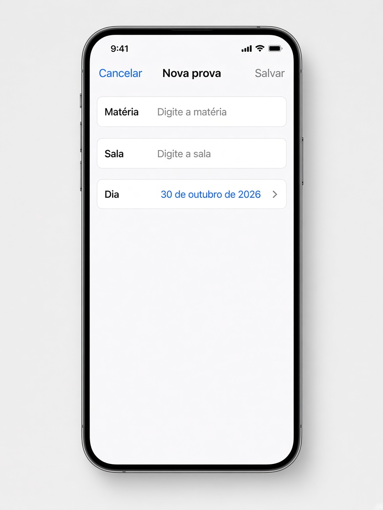

# Revisão — o que fazer

**Desenvolvimento iOS · 3º ano**

São três exercícios que misturam lista, ViewModel e navegação. Não entra gesto: sem arrastar a forma, sem pinça, sem toque longo.

Faça o seu primeiro, nos arquivos da pasta do exercício. A resolução pronta está em `Resolucoes`, na pasta do projeto, fora do app.

Em cada exercício, a parte **Componentes** diz o que usar em cada tela. O nome do componente é o que você escreve no código. O texto ao lado diz para que ele serve.

A lista mora na classe. A tela principal cria essa classe uma vez, com `@StateObject`. As outras telas recebem o mesmo objeto com `@ObservedObject`. Não crie uma segunda classe na tela filha.

Quando a tela filha precisa mudar um item, passe o `id`. Uma cópia do struct não volta para a lista.

`NavigationLink` só funciona dentro de um `NavigationStack`. A sheet sobe por cima e fecha com `dismiss()`.

Para tirar os espaços das pontas de um texto, use `trimmingCharacters(in: .whitespaces)`.

---

## 1. Estante

Pasta: `1 - Estante`

Exemplo de layout. A lista e o detalhe de um livro.

Uma pilha só. Sem aba.

No topo, um resumo: quantos livros existem, quantos estão lidos e a soma das páginas dos lidos. A soma usa `reduce`. A contagem de lidos usa `filter`.

Abaixo, a lista. Cada linha mostra o título e o autor. O toque abre o detalhe daquele livro. O arraste para o lado apaga pelo `id`.

O **+** da barra abre a sheet de livro novo. A sheet é esta:

Com título e autor vazios, **Salvar** fica cinza.

### A classe `EstanteViewModel`

Deixe pelo menos quatro livros de exemplo. Cada livro tem `id`, título, autor, páginas e se já foi lido.

A classe oferece:

- `adicionar(titulo:autor:paginas:)`
- `apagar(id:)`
- `definirLido(id:lido:)`
- uma forma de achar o livro pelo `id`

**Componentes**

- A classe adota `ObservableObject`.
- A lista fica em `@Published var livros`. Quando ela muda, a tela redesenha.
- `Livro` é `struct` e `Identifiable`. O `id` é um `UUID`.
- `filter` separa os livros com `lido` verdadeiro. O `.count` dessa lista é o número de lidos.
- `reduce` soma as páginas só dos livros lidos.
- `removeAll` apaga o livro cujo `id` é o que chegou na função.
- `firstIndex(where:)` acha a posição do livro para gravar o novo valor de `lido`.
- `first` devolve o livro daquele `id`, para o detalhe mostrar autor e páginas.

### A lista `EstanteView`

**Componentes**

- `@StateObject` cria a classe uma vez. As outras telas recebem esse mesmo objeto.
- `@State` Bool guarda se a sheet está aberta. Ele fica só nesta tela.
- `NavigationStack` em volta de tudo.
- `List` com duas `Section`: **Resumo** e **Estante**.
- `Text` nas três linhas do resumo.
- `ForEach` percorre `livros`.
- Cada linha é um `NavigationLink`. Dentro, um `VStack`: título em cima, autor embaixo, com `.font(.caption)`.
- O destino do link é `LivroDetalheView`, recebendo a classe e o `id` daquele livro.
- `.onDelete` no `ForEach`. Guarde o `id` da linha e chame `apagar(id:)`.
- `toolbar` com um `Button`. O ícone é `Image(systemName: "plus")`. O toque liga o Bool da sheet.
- `.sheet(isPresented:)` abre `NovoLivroView` e entrega a mesma classe.

### O detalhe

O título da barra é o título do livro. A tela mostra o autor, as páginas e um toggle **Lido**.

O toggle grava na classe, pelo `id`. Quando você volta, a lista e o resumo já estão atualizados.

**Componentes**

- `@ObservedObject` recebe a classe. Não use `@StateObject` aqui.
- `Form` com o conteúdo.
- `LabeledContent` para o autor e para as páginas. São textos. Não são campo editável.
- `Toggle("Lido")`. Este toggle não liga num `@State` da tela. O `Binding` lê o livro pelo `id` e grava com `definirLido(id:lido:)`.
- `.navigationTitle` com o título do livro.

### A sheet de livro novo

Campos: título, autor e um stepper de páginas, começando em 100, entre 1 e 2000.

**Salvar** fica desabilitado se o título ou o autor, sem espaços nas pontas, estiver vazio.

Ao salvar, o livro entra na classe com lido desligado, e a sheet fecha com `dismiss()`. **Cancelar** fecha sem gravar.

**Componentes**

- `@ObservedObject` da mesma classe.
- `@Environment(\.dismiss)` para fechar. A sheet não recebe o Bool que a abriu.
- `@State` para título, autor e páginas. Isso é rascunho. A classe só muda no **Salvar**.
- `NavigationStack` com título **Novo livro**.
- `Form`.
- Dois `TextField`: **Título** e **Autor**.
- `Stepper` de 1 a 2000. O texto do stepper mostra o número, no formato `Páginas: \(paginas)`.
- `toolbar` com dois `Button`: **Cancelar** em `.cancellationAction` e **Salvar** em `.confirmationAction`.
- `.disabled` no **Salvar** enquanto `podeSalvar` for falso.
- No **Salvar**, chame `adicionar` e depois `dismiss()`. No **Cancelar**, só `dismiss()`.

---

## 2. Laboratório

Pasta: `2 - Laboratorio`

Exemplo de layout. Na terceira tela, a aba Aviso é a que está selecionada.

A sheet do aviso novo é esta. Com o campo vazio, **Publicar** fica cinza.

Duas abas. As duas olham a mesma classe, criada na tela das abas.

- **Equipes**, ícone `person.3`
- **Aviso**, ícone `megaphone`

### A classe `LaboratorioViewModel`

Deixe pelo menos quatro equipes. Cada uma tem `id`, nome, tema e quantidade de integrantes.

Guarde também o texto do aviso, começando vazio.

`totalIntegrantes` soma os integrantes com `reduce`.

A classe apaga uma equipe pelo `id`, muda a quantidade de integrantes pelo `id` e publica o aviso.

**Componentes**

- `class` com `ObservableObject`.
- `@Published var equipes` e `@Published var aviso`.
- `EquipeLab` é `struct` e `Identifiable`, com `id` do tipo `UUID`.
- `reduce` soma `integrantes`.
- `removeAll` apaga pelo `id`.
- `firstIndex(where:)` acha a equipe para gravar o novo número de integrantes.
- `first` devolve a equipe daquele `id`.

### A tela das abas `LaboratorioView`

**Componentes**

- `@StateObject` cria a classe uma vez.
- `TabView`.
- Cada aba usa `.tabItem` com `Label`. O texto e o ícone ficam no `Label`: `Label("Equipes", systemImage: "person.3")` e `Label("Aviso", systemImage: "megaphone")`.
- As duas views filhas recebem a mesma classe.

### Aba Equipes

Dentro de um `NavigationStack`:

- título **Equipes**
- o texto “Integrantes: (total)”
- a lista. Cada linha mostra o nome e o tema
- cada linha é um `NavigationLink`
- o arraste apaga pelo `id`

No detalhe, o título da barra é o nome da equipe. Aparece o tema e um stepper de integrantes, de 1 a 12. O stepper grava na classe.

**Componentes da lista**

- `@ObservedObject` da classe. Não crie outra.
- `NavigationStack` só desta aba.
- `List` com o `Text` do total e o `ForEach` das equipes.
- Cada linha é um `NavigationLink` com um `VStack`: nome e tema.
- O destino é o detalhe, com a classe e o `id`.
- `.onDelete` chama `apagar(id:)`.
- `.navigationTitle("Equipes")`.

**Componentes do detalhe**

- `@ObservedObject` e o `id` da equipe.
- `Form`.
- `LabeledContent` para o tema. É texto, não campo.
- `Stepper` de 1 a 12. O `Binding` lê o número na classe e grava com `definirIntegrantes(id:valor:)`.
- `.navigationTitle` com o nome da equipe.

### Aba Aviso

Mostra o aviso publicado, ou “Nenhum aviso” quando ainda não houver.

O botão **Novo aviso** abre uma sheet. A sheet não recebe o Bool que a abriu.

Ela tem um campo e um botão **Publicar**.

- **Publicar** fica desabilitado se o campo, sem espaços nas pontas, estiver vazio
- ao tocar, grava o texto na classe e fecha com `dismiss()`

**Componentes da aba**

- `@ObservedObject` da classe.
- `@State` Bool da sheet, só nesta aba.
- `NavigationStack` com título **Aviso**.
- `VStack` com um `Text` e um `Button("Novo aviso")`.
- O `Text` usa o aviso da classe. Se a string estiver vazia, mostre “Nenhum aviso”.
- `.sheet(isPresented:)` abre o formulário e entrega a mesma classe.

**Componentes da sheet**

- `@ObservedObject` da classe.

- `@State` para o rascunho. A classe só muda no **Publicar**.
- `VStack` com `TextField("Aviso", text:)` e `.textFieldStyle(.roundedBorder)`.
- `Button("Publicar")` com `.disabled` enquanto o rascunho, sem espaços nas pontas, estiver vazio.
- No toque: `publicarAviso` e `dismiss()`.

---

## 3. Agenda de provas

Pasta: `3 - Agenda de provas`

Exemplo de layout. O alerta “Apagar esta prova?” abre por cima do detalhe, com Apagar e Cancelar.

O **+** abre esta sheet. Com matéria e sala vazias, **Salvar** fica cinza.

Uma pilha. A classe guarda as provas e também o filtro.

### A classe `AgendaProvasViewModel`

Deixe pelo menos quatro provas. Cada uma tem `id`, matéria, sala, dia e se já foi revisada.

`soPendentes` começa desligado. Com ele ligado, a lista mostra só as que ainda não foram revisadas. A ordem é pelo dia, da mais próxima para a mais distante.

`pendentes` conta quantas ainda não foram revisadas.

Dá para adicionar, apagar pelo `id` e marcar revisada pelo `id`.

**Componentes**

- `class` com `ObservableObject`.
- `@Published var provas` e `@Published var soPendentes`.
- `ItemProva` é `struct` e `Identifiable`. O dia é um `Date`. O `id` é um `UUID`.
- `visiveis` é uma lista calculada. Se `soPendentes` estiver ligado, use `filter` para ficar só com `revisada == false`. Depois `sorted`, comparando `dia`.
- `pendentes` usa `filter` e `.count`.
- `removeAll` apaga pelo `id`.
- `firstIndex(where:)` acha a prova para gravar `revisada`.
- `first` devolve a prova daquele `id`.

### A lista

Título **Provas**.

No resumo: o total e quantas estão pendentes.

Um toggle **Só as pendentes**, ligado em `soPendentes`.

Cada linha mostra a matéria, a sala e “Revisada” ou “Pendente”. O toque abre o detalhe. O arraste apaga pelo `id` do item que está na tela. Com o filtro ligado, o índice da linha não é o índice do array completo.

O **+** abre a sheet de prova nova.

**Componentes**

- `@StateObject` cria a classe uma vez.
- `@State` Bool da sheet.
- `NavigationStack` e `List`.
- `Section` **Resumo**: dois `Text` e um `Toggle("Só as pendentes", isOn: $agenda.soPendentes)`. Esse toggle liga direto na propriedade da classe.
- `Section` **Provas**: `ForEach` de `visiveis`, não do array completo.
- Cada linha é um `NavigationLink` com um `VStack`: matéria, e embaixo a sala com “Revisada” ou “Pendente”.
- `.onDelete` lê o `id` em `visiveis`, naquela linha, e chama `apagar(id:)`.
- `toolbar` com `Button` e `Image(systemName: "plus")`.
- `.sheet(isPresented:)` abre `NovaProvaView` com a mesma classe.
- `.navigationTitle("Provas")`.

### O detalhe

O título da barra é a matéria. A tela mostra a sala, o dia e um toggle **Revisada**, que grava na classe.

O botão **Apagar** abre o alerta “Apagar esta prova?”. **Apagar** remove pelo `id` e volta para a lista com `dismiss()`. **Cancelar** só fecha o alerta.

**Componentes**

- `@ObservedObject`, o `id` da prova e `@Environment(\.dismiss)`.
- `@State` Bool do alerta.
- `Form`.
- `LabeledContent` para a sala.
- Outro `LabeledContent` para o dia. O texto da data usa `Text(prova.dia, format: .dateTime.day().month(.wide).year())`.
- `Toggle("Revisada")` com `Binding` que lê a prova pelo `id` e grava com `definirRevisada(id:revisada:)`.
- `Button("Apagar", role: .destructive)` liga o Bool do alerta.
- `.alert("Apagar esta prova?", isPresented:)`. Dentro, **Apagar** com `role: .destructive` chama `apagar(id:)` e `dismiss()`. **Cancelar** usa `role: .cancel` e não apaga.
- `.navigationTitle` com a matéria.

### A sheet de prova nova

Campos: matéria, sala e a data.

**Salvar** fica desabilitado se a matéria ou a sala, sem espaços nas pontas, estiver vazia.

Ao salvar, a prova entra com revisada desligada, e a sheet fecha com `dismiss()`. **Cancelar** fecha sem gravar.

**Componentes**

- `@ObservedObject` da mesma classe.

- `@State` para matéria, sala e dia. O dia começa em `Date()`, que é hoje.
- `NavigationStack` com título **Nova prova**.
- `Form` com dois `TextField`, **Matéria** e **Sala**, e um `DatePicker("Dia", selection:, displayedComponents: .date)`. O picker mostra só a data, sem a hora.
- `toolbar`: **Cancelar** em `.cancellationAction` e **Salvar** em `.confirmationAction`.
- `.disabled` no **Salvar** enquanto matéria ou sala, sem espaços nas pontas, estiver vazia.
- No **Salvar**, chame `adicionar` e depois `dismiss()`.
